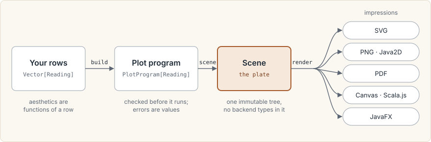

# How Intaglio works

Intaglio draws statistical graphics from ordinary Scala values. You describe a plot in terms of your
own rows, the library compiles that description into one renderer-neutral picture, and a backend
turns the picture into SVG, PNG, PDF, a Canvas drawing, or a JavaFX drawing. This page walks through
those steps once, so that the tutorial and the guides have a shape to hang on.



The name comes from printmaking. In intaglio an image is cut into a plate; the plate is inked and
pressed, and every impression it yields is the same. Here the `Scene` is the plate and each backend
makes an impression of it. Every renderer reads the same resolved device coordinates, produced once
by `DeviceScene.fromScene`, and runs the same conformance cases. SVG and Java2D renderings of one
`RenderPlan` therefore put each mark at the same device coordinates. Text can still differ in shape
when a backend draws it with platform fonts.

## Aesthetics are functions of your rows

There is no data frame and no column lookup by name. `plot` accepts any collection of your own type,
and each aesthetic is a function from one row to a value:

```scala mdoc:silent
import intaglio.*

final case class Reading(minute: Double, signal: Double, channel: String)

val readings = Vector(
  Reading(0.0, 1.20, "left"),
  Reading(1.0, 1.85, "left"),
  Reading(2.0, 2.40, "left"),
  Reading(0.0, 0.80, "right"),
  Reading(1.0, 1.10, "right"),
  Reading(2.0, Double.NaN, "right")
)

val program =
  plot(readings)
    .aes(_.minute, _.signal)
    .scaleColorDiscrete(_.channel, name = "channel")
    .geomPoint()
    .geomLine()
    .build
```

Because `_.signal` is a Scala function, the compiler checks it: a misspelt field fails to compile
instead of failing when the plot is drawn.

## A plot is a value, checked before it draws anything

`build` does not draw. It validates the scales, coordinates, and layers and returns
`Either[GraphicsError, PlotProgram[Reading]]`. A checked failure is a `Left` carrying a typed
`GraphicsError`. The places that can still throw, such as `orThrow`, constructors named `unsafe`, and
your own row functions called directly, are listed in [throwing entry points](extending/unsafe.md).

Some mistakes are caught earlier still. Calling `aes(x, y)` changes the builder's type, and
`geomPoint` requires a builder whose type says both positions are mapped. Leaving out the positions is
therefore a compile error, not a runtime surprise:

```scala mdoc:fail
plot(readings).geomPoint()
```

## Compiling produces the plate

`scene` runs the compiler: it resolves the mappings, applies statistics, trains the scales across
every layer, evaluates your functions row by row, adjusts positions, lowers each geom to graphical
primitives, and lays out the panel, axes, and legend. The result is a `Scene`, an immutable tree that contains no SVG,
Java2D, or Canvas value.

```scala mdoc:silent
val scene: Either[GraphicsError, Scene] = program.flatMap(_.scene)
```

You can also stop one step earlier. `resolve` returns the plot as the compiler understood it: the
trained scales, the resolved rows, and a report of every row it could not draw. The last reading
above has a `NaN` signal. Instead of disappearing, it is reported with its reason, once for each of
the two layers that would have drawn it:

```scala mdoc
program.flatMap(_.resolve).map(_.droppedRows.map(_.reason))
```

## One scene, many impressions

Each backend is a separate artifact that consumes a `Scene`. The SVG renderer turns it into markup:

```scala mdoc:silent
import intaglio.svg.*

val svg: Either[IntaglioError, SvgDocument] = scene.flatMap(SvgRenderer.render(_))
```

Every backend's error type, like the compiler's, extends `IntaglioError`. That shared root is why
one `flatMap` chain can compile and then render without converting between error types.

The other backends take the same scene, or a `RenderPlan` that carries it. Java2D makes a PNG on
the JVM. Canvas draws in the browser under Scala.js, and JavaFX draws into a desktop canvas. PDF
accepts only a `RenderPlan`, because the page size comes from it, and it embeds the fonts you supply
in a `PdfFontCatalog` without falling back to others. The [backend guide](backends.md) lists what each one can and cannot express.

## Bind the output size once

Layout depends on the output size. Axis labels, legend columns, and titles are measured and placed
against a concrete width, height, and resolution. The defaults agree (640 by 480 pixels at 96 DPI
for both compiling and SVG), but once you choose a size, choose it in one place: compile against a
`RenderContext` to get a `RenderPlan`, and hand the plan to the renderer.

```scala mdoc:silent
val context = RenderContext.unsafe(width = 1000, height = 600, pixelsPerInch = 144.0)

val large: Either[IntaglioError, SvgDocument] =
  program.flatMap(_.renderPlan(context)).flatMap(SvgRenderer.render(_))
```

A `RenderPlan` carries the scene together with the context that laid it out, so the renderer cannot
serialize at a different size from the one the layout assumed. `RenderContext.unsafe` throws on an
invalid size; `RenderContext.apply` returns an `Either` instead.

## Where to go next

| If you want to | Read |
| --- | --- |
| Build your first plot and write it to a file | [Tutorial 1: Data in, SVG out](tutorial/01-first-plot.md) |
| See what Intaglio can draw, with the code for each plate | [Gallery](gallery.md) |
| Choose between SVG, PNG, PDF, Canvas, and JavaFX | [Backends](backends.md) |
| Understand why the API is shaped this way | [Design decisions](adr/README.md) |
